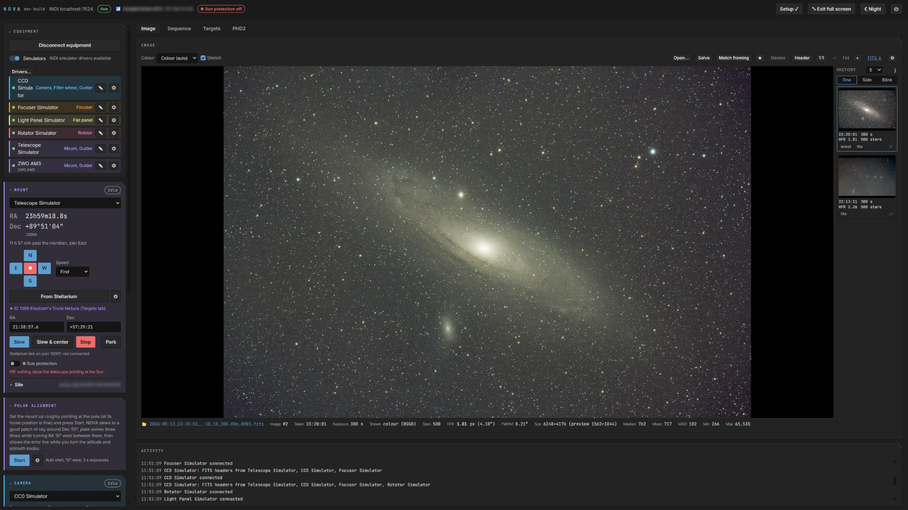
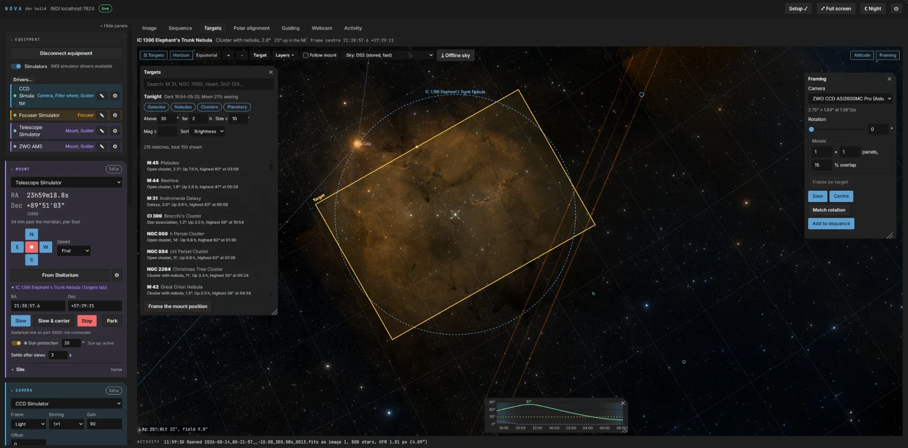
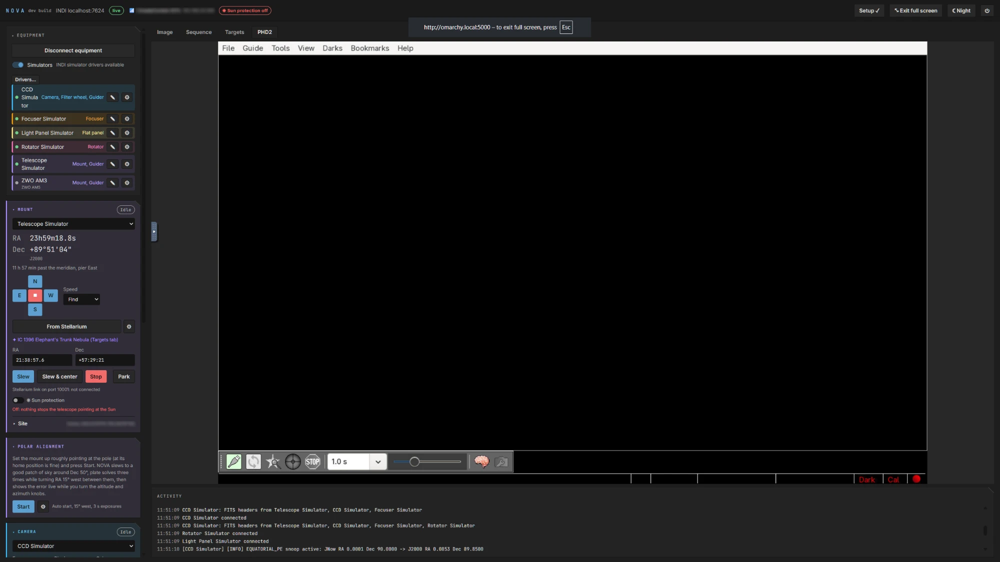

# NOVA

**Astrophotography from your browser.** NOVA runs on a small Linux computer at the telescope (a mini PC or a
Raspberry Pi) and controls your mount, cameras, focuser, filter wheel, rotator and flat panel through
[INDI](https://www.indilib.org/). You use it from a browser on any computer, tablet or phone on the same
network, with nothing to install there. It's inspired by [N.I.N.A.](https://nighttime-imaging.eu/), for Linux.



## What it does

- **Imaging:** exposures with cooling, gain, offset and binning; stretched colour previews; stars, HFR and
  FWHM for every frame; image history with side-by-side and blink comparison. FITS files are saved on the mini
  PC or straight to a USB drive plugged into it.
- **Plate solving** with ASTAP: sync, slew and centre on a target to within an arcminute; named stars on
  solved frames.
- **Targets:** offline deep-sky and star catalogues, tonight's best targets for your site, a Stellarium-style
  sky chart with survey imagery, framing with rotation and mosaics.
- **Sequences:** a whole night unattended, for several targets: centring, autofocus with per-filter offsets,
  guiding, dithering, meridian flips, flats, the camera's rotation matched for each target, and a stop at dawn.
- **Focusing** (V-curve autofocus), **polar alignment** (three-point, or with the camera on the pole),
  **guiding** through PHD2 (which runs on the mini PC and shows in a tab) or NOVA's own guider (with predictive PEC
  for strain-wave mounts, a guiding assistant and PHD2-style logs), a **flats wizard**, and a **Stellarium** link.
- **Watch the rig from indoors** with a USB webcam on the mini PC, and pop the webcam, the latest image or the guiding
  graph out into small windows that stay on screen whichever tab you're on.
- **Built for the field:** no internet needed, a red night mode, and work that carries on when your laptop
  sleeps or the Wi-Fi drops, because everything runs on the mini PC. Optional messages to your phone when a
  sequence finishes or needs you. Frames can be saved straight to a USB drive. With no Wi-Fi at the site, the mini PC
  starts its own hotspot so a phone or tablet can still reach it.
- **Works on a tablet:** the panels fold away, and the image and sky chart pinch to zoom.

## Screenshots

<table>
  <tr>
    <td width="33%"><a href="docs/images/targets-tab.webp"></a></td>
    <td width="33%"><a href="docs/images/sequence-tab.webp"></a></td>
    <td width="33%"><a href="docs/images/image-tab.webp"></a></td>
  </tr>
  <tr>
    <td><b>Targets:</b> tonight's best targets, a sky chart with survey imagery, and framing the camera on IC 1396.</td>
    <td><b>Sequence:</b> a night's imaging, with dithering, refocusing, the meridian flip and what happens at the end.</td>
    <td><b>Image:</b> every frame stretched in colour, with its stars, HFR and FWHM, and the night's history.</td>
  </tr>
  <tr>
    <td><a href="docs/images/phd2-tab.webp"></a></td>
    <td><a href="docs/images/webcam-tab.webp"></a></td>
    <td></td>
  </tr>
  <tr>
    <td><b>PHD2:</b> PHD2 runs on the mini PC without a screen, and shows in a tab (or use NOVA's own guider).</td>
    <td><b>Webcam:</b> watch the rig from indoors, full size or popped out over any tab.</td>
    <td></td>
  </tr>
</table>

## Install

On a 64-bit Arch, Debian 13, Raspberry Pi OS (trixie) or Ubuntu 26.04 system:

```bash
sudo apt install git             # Arch: sudo pacman -S --needed git
git clone https://github.com/geoffpedder/nova-astro.git && cd nova-astro
deploy/setup.sh
```

`setup.sh` installs INDI and your equipment's drivers, the ASTAP plate solver, PHD2 and NOVA itself. Then
open `http://<name>.local:5000`, where a **Getting started** checklist takes you through the rest. Later,
`nova update` installs new releases and `nova doctor` checks everything.

## Documentation

- [Installing NOVA](docs/INSTALL.md): systems, setup options, updating, troubleshooting, installing by hand
- [Using NOVA](docs/USER-GUIDE.md): every part of the page, from the first run to unattended sequences
- [Developing NOVA](docs/DEVELOPING.md): building, tests, releases and the API
- [Changelog](CHANGELOG.md)

## Status

NOVA is young. It's developed with a ZWO AM3 mount and an ASI2600MC Pro on Ubuntu Server and Arch, and tested
against INDI's simulators; every release's setup is also tested from scratch on Arch, Debian and Ubuntu in
containers. Raspberry Pi OS hasn't been tried on real hardware yet. Reports of how it works with other equipment are very welcome; please include the output
of `nova doctor`.

**Password:** optional. Without one, anyone on the same network can control the telescope, which is fine at
home or in a field; on shared networks set one (⏻ → Set a password…). Either way, don't expose NOVA to the
internet.

## Licence

NOVA is free software: you can use, study, change and share it under the terms of the
[GNU General Public License](LICENSE), version 3 or (at your option) any later version. If you distribute a
changed version, it must be under the same licence, with its source.

Copyright (C) 2026 Geoff Pedder.

## Credits

NOVA uses the HYG star database, OpenNGC, GeoNames, Natural Earth, d3-celestial's constellation figures, and
the Inter and JetBrains Mono fonts; see [NOTICE](NOTICE) for their authors and licences. It contains no code
from N.I.N.A. and isn't affiliated with it.
