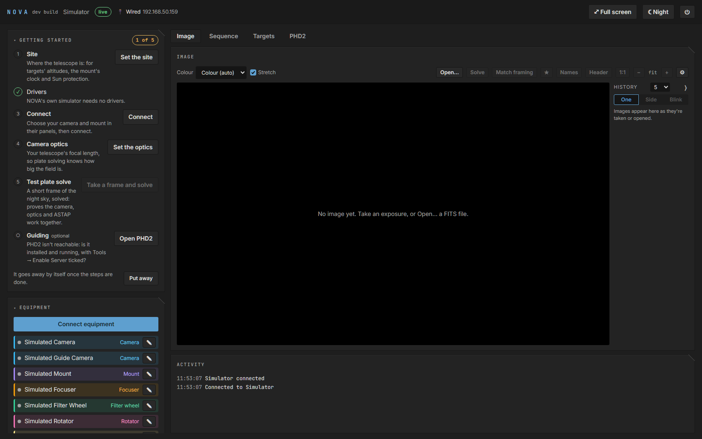
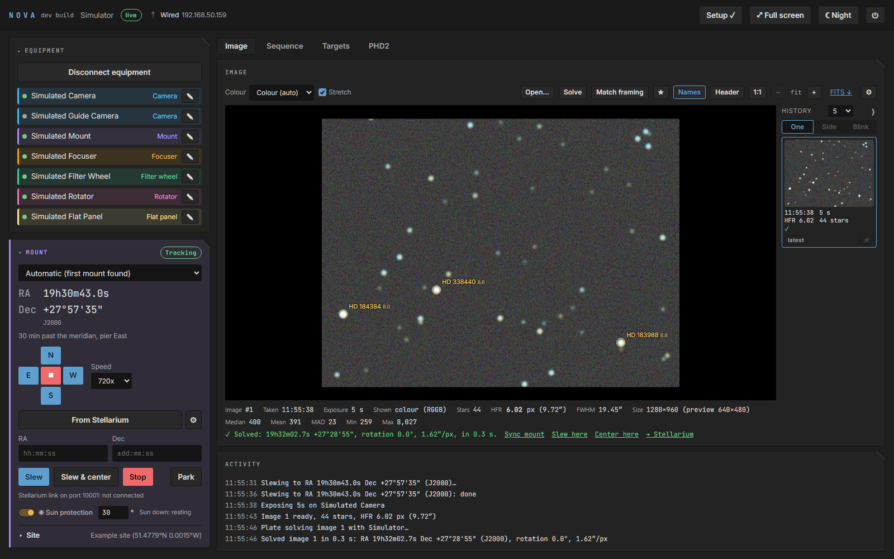
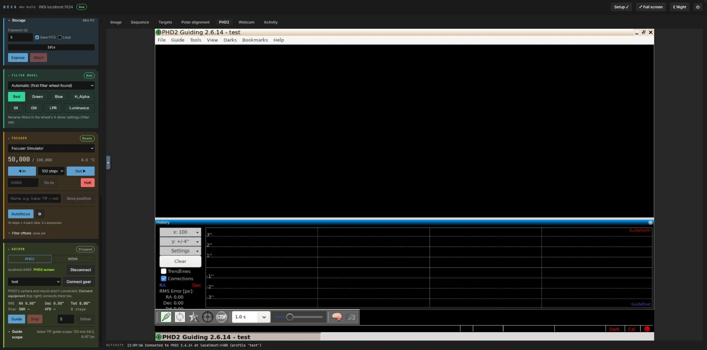
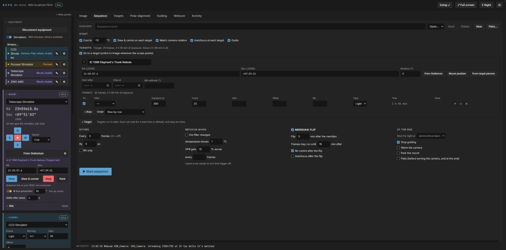
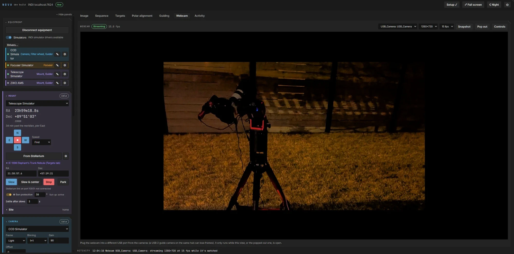

# Using NOVA

- [Getting started](#getting-started)
- [The page](#the-page)
- [Equipment and drivers](#equipment-and-drivers)
- [Mount and site](#mount-and-site)
- [Camera and optics](#camera-and-optics)
- [Plate solving](#plate-solving)
- [Focusing](#focusing)
- [Polar alignment](#polar-alignment)
- [Guiding](#guiding)
- [Targets and framing](#targets-and-framing)
- [Sequences](#sequences)
- [Flats](#flats)
- [Image history](#image-history)
- [Stellarium](#stellarium)
- [Webcam](#webcam)
- [Notifications](#notifications)
- [The mini PC](#the-mini-pc)
  - [Wi-Fi hotspot](#wi-fi-hotspot-no-wi-fi-at-the-site)

## Getting started

The first time you open NOVA, a **Getting started** checklist at the top of the left column leads you
through the setup:

1. **Site:** where the telescope is. NOVA needs it for targets' altitudes, the mount's clock and Sun
   protection.
2. **Drivers:** the INDI drivers for your equipment (Equipment → Drivers…).
3. **Connect:** the camera and mount.
4. **Camera optics:** your telescope's focal length, so plate solving knows how big the field is.
5. **Test plate solve:** a short frame of the night sky, solved. It proves the camera, optics and the plate
   solver work together.
6. **Guiding** (optional): PHD2 running, with a profile for your guide camera and mount.

Each step ticks itself when it's done and has a button that opens the place where it's done. Below the
steps, **On the mini PC** lists anything missing there (a chosen driver that isn't installed, the plate
solver, PHD2), each with the command that fixes it; click a command to copy it.

The checklist goes away once the steps are done. **Setup** in the header brings it back: it reads
"Setup ✓", or how many things are left to do. **Put away** hides it before then.

## The page

- **Left column:** the equipment panels (Equipment, Mount, Camera, Focuser, Filter wheel, Rotator, Flat
  panel, Guider). Click a panel's title to fold it away; NOVA remembers.
- **Main area:** the **Image**, **Sequence**, **Targets**, **Polar alignment**, **PHD2** (or **Guiding**, with NOVA's
  own guider), **Webcam** and **Activity** tabs.
  Underneath, one line shows the latest activity (yellow for a warning, red for an error); click it for the
  **Activity** tab, the whole log, with *Warnings and errors only* to pick out problems. A dot on the tab means a
  warning or error came in since you last looked. Above the log, **Mini PC** shows its CPU use (with load and
  temperature), memory in use (and NOVA's share), free space on the image disk (and the USB drive when frames go
  there) and how long it's been up; the bars turn yellow at 75% and red at 90%.
- **Header:** the connection, the network (click it for the **Network** dialog and the
  [Wi-Fi hotspot](#wi-fi-hotspot-no-wi-fi-at-the-site)), a running sequence's progress (from any tab), **Setup**,
  **Full screen**, **Night** (everything in red, to keep your night vision) and ⏻ (restart or shut down the
  mini PC).

Everything runs on the mini PC: closing the browser, or a laptop going to sleep, doesn't stop an exposure or
a sequence. Open NOVA from as many browsers as you like; they all show the same thing.

**On an iPad or phone, add NOVA to the Home Screen** (Safari: Share, then *Add to Home Screen*). It then opens
as its own app, filling the screen without Safari's bars. That's steadier than Safari's **Full screen**, which a
swipe down (easy to make by accident while using NOVA) closes.

**On a tablet:** **◂ Hide panels** (top of the panel column) folds the column away to a strip down the left edge;
click the strip to bring it back. Each browser remembers its own layout. Pinch with two fingers to zoom the image and the
Targets tab's sky chart. To open NOVA like an app, add it to the home screen (Safari: Share → Add to Home Screen); it
gets NOVA's star icon.

**Pop-outs:** the Webcam tab, the Image tab and the guiding graph (Guiding tab, or under the Guider panel's graph)
each have **Pop out**, which keeps a small window of it on screen whichever tab is showing. Drag one by its title,
resize it from its bottom-right corner; ⤢ opens its tab, ✕ or **Pop out** again closes it. Each browser remembers where
they are, and they stay inside the browser window when it's made smaller.

## Equipment and drivers

**Equipment → Drivers…** lists the INDI drivers installed on the mini PC by their proper names, grouped by
kind (mounts, cameras, focusers…), with a search box. **All installed / Ticked / Running** narrows the list to
the ones you've ticked, or those with a device connected right now. Tick the ones for your equipment and press **Apply**.
NOVA saves the choice and starts and stops drivers straight away (stopping one disconnects its devices). A
ticked driver that isn't installed shows the package that provides it.

The devices the drivers find appear in the Equipment panel. Pick which camera, mount, focuser and so on to use
in their own panels (automatic picks the first one found), then press **Connect equipment**, which also
connects PHD2's camera and mount. ✎ gives a device a nickname; ⚙ opens all of its driver's settings
(for example a mount's serial port). New devices that appear while connected are connected too.

**Profiles** (under Connect equipment), like the site and optics presets, save a whole setup to load later: the
device for each role (what "automatic" picked is saved as that device), the INDI drivers, the Simulators switch
and how the mount connects (USB or Bluetooth, and which mount). Type a name and press **Save**; **Save current**
updates the profile shown with what's in use now. Picking a profile while equipment is disconnected loads it: the
drivers it needs start, the rest are stopped, and the devices are chosen, ready for **Connect equipment**.

A mount or other serial device that isn't on the port its driver expects (it was plugged in after INDI started,
say, or came up as `/dev/ttyACM0` rather than `/dev/ttyUSB0`) still connects: when connecting fails, NOVA rescans
the ports and tries each one, as the driver's *Scan Ports* button does by hand, and the activity log says which
port it was on.

**Simulators,** for trying NOVA without hardware: tick INDI's simulator drivers in Drivers… (the telescope,
CCD, focuser, filter wheel and other simulators). The **Simulators** switch in the Equipment panel then
stops and hides them while you use real equipment, and brings them back, without changing the driver list.

## Mount and site

The Mount panel shows where the mount points (J2000; hover for the mount's own JNow), its pier side and time
past the meridian. **Unpark**, **Park** and **Stop**; the arrow pad moves it by hand at the chosen speed
(■ stops). Until you choose one, that's the fastest up to 720x (also in ZWO's Heavy Duty Mode), set as soon as
the mount connects; a speed you choose is remembered. Type coordinates or take them from the Targets tab, then **Slew**, or **Slew & center**: slew,
then expose, plate solve and correct until the target is within 1′.

**Bluetooth (ZWO AM3, AM5 and AM7):** the mount can connect without its USB cable. Under the mount's name,
set **Connection** to **Bluetooth**: NOVA searches for a few seconds and lists the ZWO mounts in range, with their
signal. Pick yours (`AM3_68bc8d`, say); NOVA remembers it. From then on **Connect equipment** connects the mount
over Bluetooth, the same driver as over USB, and the Mount panel shows the link (looking for it, connected). If the
link drops, NOVA reconnects by itself; the mount doesn't answer until it's back. **Disconnect equipment** lets the
mount go, so ZWO's phone app can connect to it again; **USB cable** goes back to the cable.

**The first time, press the mount's BT button.** Each NOVA has its own code for the mount, and a mount that
doesn't know it yet waits for its **BT** button to be pressed (the Mount panel says so). It then remembers this
NOVA and connects without asking again. NOVA only ever connects to the mount you picked, never just any mount in
range, so at a site with several ZWO mounts it can't take over someone else's by mistake, and another NOVA can't
use yours without someone pressing its button. (ZWO's phone app uses one code for everyone, so a mount that has
been used with the app still accepts the app.)

A mount only shows in the search while nothing else is connected to it: close ZWO's app on your phone first. The
mini PC needs Bluetooth (most have it; a USB Bluetooth dongle works) and `nova setup` installs what NOVA needs for
it (BlueZ and Python's Bleak). `nova doctor` checks it.

**Site** (at the bottom of the Mount panel): add your observing sites by coordinates or on the offline
world map. The active site, and the mini PC's clock, are sent to the mount whenever it connects. Sites show by name
only (in the Site line, the setup guide and the activity log), so a screenshot doesn't give your location away; the
coordinates show only while the Site section is open.

**Settle after slews** (Mount panel, 3 s by default): after every GoTo (Slew, each centring attempt, a sequence's
next target, a meridian flip) NOVA leaves the mount this long before it exposes, solves or moves on, so a mount
still ringing from the slew doesn't trail the stars in a solve frame. 0 turns it off. After a flip, the flip's own
settle time counts from the same moment, so the longer of the two applies.

**Sun protection** keeps the telescope at least 30° (adjustable) from the Sun while it's up, for slews and
for moving by hand. It can be switched off for testing indoors; the header then shows a red warning.

## Camera and optics

The Camera panel sets the exposure, gain, offset, binning, frame type and cooling, and **Expose** takes a
frame (saved as FITS when **Save FITS** is ticked, to `~/Pictures/Nova`). **Open ▾** in the Image tab opens a FITS
file *from this computer*, or *from the mini PC*: its image folders (and a mounted USB drive), night by night, for a
frame from an earlier run that hasn't been copied off yet. The Image tab shows it stretched, in colour for colour cameras, with the
star count, HFR, FWHM and statistics underneath; **Names** labels the stars once the frame is solved, and
**Header** shows the FITS header. **Expose** at the start of the Image tab's toolbar takes a frame with the Camera
panel's settings (exposure, Save FITS, Loop) and becomes **Abort** while it exposes, handy with the panels folded
away. The seconds box beside it is the Camera panel's exposure: change it in either place.
**Pop out** opens the latest image in a small window that stays on screen whichever tab is showing, following each
new frame (drag it by its title, resize it from its bottom-right corner; ⤢ goes to the Image tab, ✕ or **Pop out**
again closes it).

**Default gain and offset:** camera drivers start with their own (the INDI ZWO driver's gain is 200). A ZWO imaging
camera gets **gain 100, offset 50** from NOVA each time it connects: at 100 the newer ZWO sensors (ASI2600, ASI533
and others) switch to their low-noise mode, at about unity gain. For other values, or another camera, set the gain
and offset you want, then **Make these the default** under them. Sequence rows with a gain or offset filled in still
use their own. The cooling target starts at -10 °C.

**Dew heater:** a camera with a heater around its window (ZWO's cooled Pro cameras) has a **Dew heater** switch
under the cooler. Turn it on when cooling on a damp night, so the window doesn't dew up or frost over. It's on or
off, with no power setting.

**Optics** (in the Camera panel): presets of focal length and aperture, e.g. one for the telescope and one
with a reducer. The presets are shared by every camera, so a second camera on the same telescope (or one
swapped in) just picks the same preset; each camera remembers its own choice. Changing a shared preset
changes it for every camera using it. The active preset is written into the FITS headers and tells the plate
solver and the Targets tab how big the field is.

**Storage** (in the Camera panel): where frames are saved, on the **Mini PC** (`~/Pictures/Nova`) or a **USB
drive** plugged into it (in a `Nova` folder on the drive). Each night gets a folder either way
(`2026-10-10/M 31/...`).

- A chosen drive is mounted as soon as it's plugged in, and used again whenever it's back.
- Starting a sequence warns if its frames won't fit on the drive.
- If the drive is missing, full, can't be written or is pulled out mid-night, frames go to the mini PC instead
  (none are lost), the activity log says why, and your phone is told if notifications are on.
- **Eject** finishes the frame being saved and unmounts the drive: unplug it after that. Until it's plugged in
  again, frames go to the mini PC.
- **Copy a night from the mini PC** copies a night saved on the mini PC to the drive, skipping files already
  there, for when you'd rather save locally and take a copy home in the morning. Each file is written all the way
  to the drive before it counts as copied (so it takes as long as the drive needs), and a file only counts as
  already there if it's a finished copy: one left half-written by a drive pulled out early is copied again.
  **Eject** before unplugging, all the same.

Drive formats:

| Format | Works? | Notes |
|---|---|---|
| **exFAT** | Yes (best) | The usual format for USB sticks and cards over 32 GB; reads and writes on Windows, macOS and Linux. |
| **FAT32** | Yes | FITS files (about 50 MB each) are well under its 4 GB file limit. Windows only formats it up to 32 GB. |
| **NTFS** | Yes | Drives formatted on Windows. Macs read it but can't write to it without extra software. |
| **ext4, Btrfs, XFS** | Only once made writable | Linux formats keep file ownership: a freshly formatted drive belongs to `root`, so NOVA saves on the mini PC and says it couldn't write. Once mounted, `sudo chown <you> /run/media/<you>/<label>` (Arch) or `/media/<you>/<label>` (Ubuntu) fixes it for good. Windows can't read them. |
| **APFS, HFS+** (Mac) | No | Reformat as exFAT. |

To format a drive as exFAT: on Windows, right-click it in File Explorer → **Format** → *exFAT*; on a Mac, Disk
Utility → **Erase** → *ExFAT*. Formatting erases the drive.

## Plate solving

NOVA plate solves with [ASTAP](https://www.hnsky.org/astap.htm) and its star database in /opt/astap.
**Solve** in the Image tab solves the frame on screen, using the mount's position as a hint, then offers
**Sync mount**, **Slew here** and **Center here**. Solving needs the right optics preset and a star database
that suits the field of view (d05 for wide fields, d50 for long focal lengths).

Settings in `/etc/nova/nova.env`: `Nova__SolveExposureSeconds`, `Nova__CenterToleranceArcmin`,
`Nova__CenterMaxAttempts`, `Nova__SolveSearchRadius`, `Nova__AstapPath`, `Nova__AstapDatabase` (e.g. `d20`).

## Focusing

The Focuser panel moves the focuser in and out, goes to a position and saves named positions (presets).
**Autofocus** runs a V-curve: it steps through focus, measures the stars' HFR at each point, fits the curve
and finishes at the sharpest point. Its settings (⚙): the step size, the number of steps each side of focus,
the exposure, and the focuser's backlash. Sequences refocus by themselves (see below).

**Backlash** (in the autofocus settings, for every focuser move): a focuser's gears have some slack, so the same
position can give a slightly different focus depending on which way the focuser came. With *Backlash (all moves)*
set, every move arrives from the same direction, the *Final approach* (inward, the usual; outward if a heavy camera
or the scope pointing high pushes the focuser in): a move that would arrive the other way goes that many steps past
the target and comes back, as NINA's overshoot method does. It applies to autofocus, filter offsets, In/Out, Go to
and saved positions alike, so a filter change lands where the offsets say. Start with a little more than the slack
(a few tens of steps for most focusers; the ZWO EAF rarely needs any); 0 turns it off.

**Filter offsets** (Focuser panel, with a filter wheel): filters focus at slightly different positions. With
offsets on, every filter change, by hand or in a sequence, moves the focuser by the difference between the two
filters, so a sequence needn't refocus after each filter change (untick *Refocus when the filter changes*).
**Measure…** autofocuses with the reference filter (your first, unless you choose another), then with each other
filter and the reference again, a few times over (3 passes by default), and averages; the result lists every
filter's individual measurements, so you can see how consistent they are. Measure on a steady night, high up,
with autofocus exposures long enough to average out the seeing: a single autofocus can scatter by tens of
steps, as much as the offsets themselves. **Edit** types them in instead.

## Polar alignment

The **Polar alignment** tab has two methods. Both show the remaining error live, in degrees, minutes and
seconds with which way to turn each knob, on a target chart that zooms in as the error shrinks (rings at 30″, 1′
and 5′), while you turn the mount's altitude and azimuth knobs. Press **Done** when it's small enough.

- **Three-point** (as N.I.N.A.'s TPPA plugin): NOVA solves a frame, turns RA, solves, turns RA again and solves
  a third time, then works out where the mount's axis points. With *Slew to the start first* (the default) it
  starts from the home position, slewing to just above the pole (2° above and 1° east of it, adjustable) and
  turning RA 10° east between points, so the field stays low in the north and never climbs towards the zenith.
  It works almost anywhere above about 15°, including right next to the pole; avoid straight overhead and due
  east or west, where the knob readings blur.
- **On the pole** (as SharpCap): the camera looks at the pole with Polaris in view. NOVA solves, turns RA 90°,
  solves again, and from the way the stars turned finds the exact pixel the mount turns about: its axis. The
  live frame then shows the axis with rings at 5′, 1′ and 30″, the pole and Polaris: turn the knobs until the
  pole sits in the rings. Markers off the frame get an arrow at its edge. Needs a field of at least about a
  degree, and a mount whose RA axis NOVA can drive (or turn it by hand).

For mounts without GoTo, tick *Turn RA by hand*: you turn RA yourself, and NOVA carries on once it has turned far
enough (or press **Continue**). The settings also choose which way RA turns, the exposure, and whether to aim at
the refracted pole.

## Guiding

The Guider panel's switch at the top picks the guider: **NOVA**, NOVA's own guider (the default on a new install,
see [below](#novas-own-guider)), or **PHD2**. An install from before NOVA had its own guider stays on PHD2 until you
switch. Guide, Stop, Dither, the RMS and the graph work the same with either, and so do
sequences: they guide, dither and wait for settling with whichever is chosen. **Pop out** (under the Guider panel's
graph, or beside the Guiding tab's) opens the graph and RMS in a small window that stays on screen whichever tab is
showing; move it by its title, resize it from its corner.

### PHD2

NOVA guides through [PHD2](https://openphdguiding.org/), which runs on the mini PC on a virtual screen; see
it in the **PHD2** tab. The first time, PHD2 opens its *New Profile Wizard* there: create a profile (your guide
camera as *INDI Camera*, the mount as *INDI Mount*), then tick **Tools → Enable Server**. PHD2's windows have title
bars to drag them by, and the taskbar along the bottom of its screen lists them all: click one to bring it to
the front. A dialog PHD2 is waiting on always stays in front.

**Guide scope** (in the Guider panel): the guide camera's focal length and aperture, sent to its driver whenever it
connects (PHD2 connects it). PHD2 doesn't need them, but the driver warns *Telescope focal length is missing*
without them, and they go into the guide frames' FITS headers. Then the Guider panel picks the profile, connects PHD2's
equipment, starts and stops guiding and dithers, with the guide graph and RMS. Sequences guide, dither and
wait for settling by themselves.

NOVA also watches the Dec corrections. If after 5 minutes of guiding nearly all of them push the same way, the
star is drifting, which is what polar error does: the Guider panel and the activity log say how fast, and the
least polar error that would cause it ("polar alignment at least 1.5° off"). Polar align again; no guide setting
makes up for a large error.

Calibrate near the celestial equator and the meridian (with either guider): **Layers → Calibration area** on the
Targets chart shades that patch of sky (within 1.5 hours of the meridian and 20° of Dec 0).

### NOVA's own guider

NOVA can guide by itself, with no PHD2, no virtual screen and nothing to set up beyond the Guider panel. It's the
default on a new install; PHD2 is still there (setup installs it) if you'd rather use it, and you can switch at any
time.

- **Profiles** (the list at the top): save the guide settings under a name (**Save as…**: camera, output, exposure,
  gain, binning, darks and the algorithms), and switch between them, e.g. one per guide scope or for windy nights.
  Built in: *NOVA defaults*, *ZWO AM mount* (1.5 s, gain 60) and *Poor seeing* (3 s, gentler corrections); these set
  the exposure, gain and algorithms and keep the equipment. The list shows *Custom* once the settings were changed.
  With a ZWO AM mount (AM3, AM5) NOVA sets *ZWO AM mount* the first time it sees one, unless the settings were already
  changed, and its dithers default to 2.5 guide pixels with settling within 0.7 px for 8 s (the Guider panel, the
  Guiding tab and new sequences), as an AM's guide pixel is several imaging pixels.
- **Camera**: the guide camera (*Automatic* takes the first camera that isn't the imaging camera). **Pulses to**: the
  mount (pulse guiding, as with the ZWO AM3/AM5), or a guide camera's ST4 port. **Exposure** (2 s is a good start)
  and binning. **Gain**: set on the guide camera before every frame (its range shows beside it); empty leaves it as
  the driver has it. Darks are taken at this gain too.
- **Loop** exposes the guide camera and picks a guide star: the brightest one that isn't saturated, crowded or near
  the edge, plus up to 8 more whose average cancels some of the seeing. The small view shows the star (yellow ring)
  and where it should be (green cross).
- **Calibrate** measures how guide pulses move the star: north until Dec backlash is taken up, west until the star has
  moved 25 pixels and back east, then north and back south. The summary shows each axis's direction and speed and how
  far from square they are; over 10° is a warning to calibrate again. **Graph** (and the Guiding tab) draws it as PHD2
  does: where the star went after each West/East step (blue) and North/South step (red). Two straight lines crossing
  square is a good calibration; a bent or short Dec line usually means Dec backlash. **Guide** calibrates first when there's no
  calibration yet. A calibration is kept (in `guider.json`) for that camera, output and binning, adjusted for where
  the scope points (RA moves less sky towards the pole) and for meridian flips; **Clear** forgets it.
- **Guide** locks on the star where it is and corrects every frame. RA uses PHD2's *Hysteresis* (70%
  aggressiveness, 10% hysteresis, min move 0.15 px), Dec its *Resist Switch* (100%, 0.2 px), which corrects one way and
  is slow to reverse, as Dec mostly drifts one way. Max pulse 2.5 s. **Dither** moves the lock position up to the
  given pixels and waits for the star to settle there. Lost the star (clouds)? It keeps looking where the star should
  be and carries on when it's back.
- **Dark library**: hot pixels, and especially warm clusters of them, look like faint stars that never move; a guider
  locked on one can't calibrate or guide. Take darks once per guide camera: put the cap on the guide scope, pick the
  exposures (highlighted; all of them for a first library, then the ones it has) and how many each (5), stop the
  guide camera, and press **Take darks**.
  NOVA combines each set into a master dark (the median, so stray cosmic rays go) and subtracts the matching one from
  every guide frame, or the nearest exposure's, scaled. They're kept per camera and binning (in `guide-darks` in the
  settings folder) with the gain they were taken at: change the gain and they're not used until you take them again.
  **Use** turns them off; **Clear** deletes them. Taking them again after a few months does no harm, as sensors gain
  hot pixels with age.
- **Guiding settings** has those numbers, Dec corrections both ways, one way or off, the calibration step (0 works it
  out from the Guide scope optics and the mount's guide rate) and *Reverse Dec after flip*, for mounts whose Dec
  pulses change sense after a flip. ZWO's AM mounts need it, so it's turned on for them; if Dec runs away after a
  flip on another mount, turn it on there too.

**The Guiding tab** (it takes the PHD2 tab's place while NOVA is the guider) shows it all full size: the whole guide
frame with the guide star (green square, the cross where it should be) and the stars averaged with it (yellow rings,
dashed when the last frame missed them), the guide star close up, the RMS and peaks, the calibration, and a large
graph of the last 300 steps (10 minutes of 2 s frames; a dashed line marks each dither, and the steps while
guiding settles after it are shaded and left out of the RMS, so a dither doesn't look like bad guiding). It has the Loop, Calibrate, Guide, Stop and Dither buttons,
the exposure, and how bright to show the frame: **Low** (black background, just the stars), **Med** (the default)
or **High** (the full auto stretch, for finding faint stars, noise and all); each browser remembers it. **Click a star** in the frame to guide on it instead; while guiding, guiding carries on from that star.

**Predictive PEC** (Guiding settings, RA *Algorithm*): mounts have a periodic error in RA, and a strain-wave mount like
the AM3 a large, fast one. Hysteresis only corrects it after it shows; Predictive PEC learns it while guiding (the RA
error plus every correction sent, so the mount's own motion), finds its period, and corrects each frame's predicted
wander ahead of time, with a gentler reactive part (*Reactive*, 50%) for the rest. It needs two cycles of the
period before it predicts (often 10–20 minutes), guiding as Hysteresis until then; the Guiding tab shows *learning*
or *predicting* with the period, how much of the motion it explains and its size. *PE period* 0 finds it; the
guiding assistant reports it from a long enough run if you want to set it. It starts learning again when guiding
starts (after a slew), after a meridian flip and after a minute without frames; dithers don't disturb it. The
built-in profile *ZWO AM mount + PEC* turns it on with the AM settings.

**Dec backlash compensation** (Guiding settings, Dec *Backlash comp*, on by default): Dec gears have some slack, so
when a correction reverses (north after south), the first part of the pulse only takes up the slack and the star
doesn't move, and guiding lags behind after every reversal. Calibration measures it (the South steps come back short
of the North ones by the backlash) and the Guiding tab shows it ("Dec backlash 9.6″ (750 ms)"). Guiding then adds
that much pulse whenever Dec reverses, and adjusts it as it goes: if the star still needs pushing the same way the
frame after, the next reversal gets a little more; if it overshot, less. Under half a pixel measured counts as no
backlash. It matters most when Dec reverses often (polar alignment close to perfect, or Dec corrections both ways);
with Dec drifting steadily one way, Resist Switch rarely reverses anyway. Calibrate again after changing the
mount's Dec balance or gear mesh, as both change the backlash.

**Seeing or settings?** Under the graph (and under the Guider panel's graph, with PHD2 too) NOVA says what limits the
guiding, once there are 30 steady steps: *seeing-limited* (errors the size of the seeing: nothing to gain),
*within the min move* (the guider is leaving small errors alone on purpose), *see-saws* (corrections overshoot or chase
the seeing: lower the aggressiveness or raise the min move), or *lags* (slow wander the corrections don't catch:
raise the aggressiveness). It also says how much guiding adds to star size (FWHM ≈ 2.35 × the total RMS) next to the
latest frame's FWHM, to show whether it matters.

The **Assistant** button (Guiding tab) is PHD2's Guiding Assistant: for 1–5 minutes it follows the star with
corrections off and measures the seeing (the frame-to-frame jitter no guider can follow), the drift (Dec drift gives
the least polar error) and RA's slower wander (periodic error). It suggests min moves just above the seeing jitter, and
longer exposures when the seeing is poor; **Apply** takes them. Run it after calibrating, so it measures along RA and
Dec, and with the scope near where you'll image.

**Guide logs**: NOVA's guider writes a log of every calibration (each step and the result) and every guide frame
(offsets, the error on each axis, the pulses sent, the star's brightness and SNR), with dithers, settling, lost stars
and settings changed mid-run. It's in PHD2's guide-log format, so the tools made for PHD2's logs can open it. One file
per night, `NOVA_GuideLog_<night>.txt` in the night's image folder (on the USB drive when frames go there), so it's
copied along with the night's frames. The Guiding tab lists the latest to download; **Guide log** in Guiding settings
turns it off.

Set the **Guide scope** optics, so the RMS and the calibration are in arcseconds. The Dec drift warning works the
same as with PHD2.

## Targets and framing

The **Targets** tab finds and frames what to image:

- **The sky chart fills the tab.** The target list, the framing controls and the altitude chart float over
  it. Hide each one with its ✕, and bring it back with the **Targets**, **Framing** and **Altitude** buttons
  in the chart's toolbar. Picking a target from the list hides the list and shows the framing controls.
  Move a panel by its heading (the altitude chart from anywhere on it), resize it from its bottom-right corner;
  double-click its heading to put it back, or **Layers → Put panels back** for all three. Each browser remembers them.
- **Search** the offline deep-sky catalogue by any name: `M 31`, `NGC 7000`, `C 20`, `Sh2-129`, `Heart`,
  `north america`. The planets and the Moon are found by name too.
- **Tonight** rates every object for the coming night at the active site: hours of darkness above an
  altitude, highest point, Moon distance. Filter by type, size and magnitude; sort by best, size, brightness
  or transit.
- **Sky chart**, Stellarium-style: drag to look anywhere, scroll to zoom from the whole sky to arcminutes.
  Horizon view (level horizon, compass points) or equatorial (north up); stars, constellation figures,
  deep-sky outlines, the Sun, Moon and planets, and survey imagery when zoomed in. Click any object, or any
  point of sky, to target it. The mount's position is shown live with its camera frame, and *Follow mount*
  keeps it centred while it slews. **Layers** turns the target, mount and solve boxes on and off, and can shade
  the best patch of sky for calibrating guiding.
- **Framing:** the camera's field (sensor size and active optics preset) on the chart, dragged into place,
  rotated (position angle of the frame's top, north through east) and optionally split into a mosaic. The
  rotation starts at 0° each time the page opens. The last plate solve shows in green, with how far to turn
  the camera to match the plan.
- **Slew**, **Centre** (slew, solve and correct) or **Add to sequence** (one target per mosaic panel, with
  the framing's rotation). The altitude chart shows the night, twilight and the Moon.
- **Match framing** (Image tab): frames exactly what the image on screen shows, for example a FITS file from
  an earlier night. NOVA plate solves it first if needed, then switches to Targets with the frame set to the
  image's centre and rotation. If the image came from a different camera or telescope, NOVA says so.
- **Match rotation**, for a camera turned by hand: NOVA takes a frame, solves it and says which way to turn
  the camera ("Turn the camera 12° clockwise, as seen from behind it"), with a dial. Press *Turned it: check
  again* until it's within 1°, then it re-centres. A frame turned 180° covers the same sky, so it never asks
  for more than 90°. If a turn moves the angle the opposite way, NOVA swaps clockwise and anticlockwise for
  your setup and remembers that. **With a rotator,** NOVA turns it instead, measuring after each move, and
  learns which way it turns the sky.

**Sky imagery,** chosen in the chart's toolbar:

- **DSS (stored, fast),** the default: the DSS colour survey as HiPS tiles (CDS), drawn by the page itself so
  panning and zooming are instant. The mini PC keeps every tile it shows in `~/.config/nova/sky/DSSColor/`.
  **⤓ Offline sky** downloads whole levels in advance for the field: level 5 (about 13″ per pixel, 16 380
  tiles, roughly 1 GB) suits framing at a few hundred mm. A stopped download carries on where it left off.
- **High-res DSS** (colour or red) and **wide-field Mellinger:** rendered for each view by CDS's
  [hips2fits](https://alasky.cds.unistra.fr/hips-image-services/hips2fits) service. Slower and online only,
  but as sharp as the survey goes. Cached in `~/.config/nova/survey-cache/`.

Without imagery the chart draws catalogue stars.

## Sequences

The **Sequence** tab runs a night's imaging unattended, for one target or several in turn:

1. **Start:** cool the camera. Then for each target: wait for its *start after* time and until it's above
   its *minimum altitude* (or the horizon), slew and centre (plate solving), optionally match the camera's
   rotation, autofocus with its first filter, start guiding.
2. **Frames:** rows of filter × exposure × count (optionally gain, offset, binning, frame type), taken row by
   row or cycled (L, R, G, B, L…, so clouds later still leave a full set). Saved to `<night>/<target>/` in the
   image folder.
3. **Between frames:** dither every N frames (waits for PHD2 to settle); refocus when the filter changes, the
   temperature moves (2 °C by default), HFR gets worse or every N frames; restart guiding if it stopped.
4. **Meridian flip** (German equatorial mounts): once the target is N minutes past the meridian, stop
   guiding, GoTo the target again so the mount changes sides, re-centre, optionally refocus, and guide again.
   A frame that would run past the latest time isn't started; the sequence waits for the flip. Flips happen between
   frames, so one due while a frame runs comes when that frame ends: the Sequence tab shows when it will actually be
   ("flip ≈ 22:31, after this frame (latest 22:41)"), and the log warns about 5 minutes ahead. If the mount
   stays on the same side (some track past the meridian until their own limit), it retries every few minutes
   and stops after three tries.
5. **End:** stop guiding, optionally take flats, warm the camera gradually, park.

**The night ends** at astronomical dawn unless you choose otherwise (At the end → *Stop the night at*: nautical
dawn, sunrise, a set time, or never). From then no frame is started that wouldn't finish in time, targets still to
come are skipped, and the end steps run. The Sequence tab shows when that will be. A sequence started after
dawn (testing in morning twilight, say) runs until the next one. Dawn needs your site, set in the Mount panel;
where the Sun never gets 18° down (short summer nights far north) it uses nautical dawn or sunrise.

**Pause** (after the current frame), **Resume**, **Skip row** and **Abort** work while it runs. A target ends
when its frames are done, at its *stop at* time (no frame is started that would run past it), or when it
sinks below its minimum altitude. One whose window has passed, or that won't rise in time, is skipped.
Frame counts, *Refocus when* and *At the end* (including when the night ends) can be changed while it runs; the
rest is fixed once it starts. Sequences are saved by name in `~/.config/nova/sequences/`.

## Flats

**Flats…** in the Sequence tab, for a panel switched on by hand (or a T-shirt or tablet): NOVA asks you to
put the panel on, then finds the exposure for the brightness you want (50% of full scale by default) from a
few test frames, and remembers it for next time. It takes the flats, checking each one and retaking any that
are off. Then it asks you to switch the panel off and cover the scope, and takes as many dark flats at the
same exposure. If even the shortest exposure is too bright, it asks you to dim the panel. They're saved in
the night's folder under `Flats/<name>/`, as `Flat` and `Dark` frames.

**With a flat panel NOVA can control** (an INDI light box or flip-flat), nobody needs to be at the scope: NOVA
closes the cover, switches the light on and sets its brightness, dimming or brightening it as needed. For
dark flats it switches the light off, then opens the cover again if it was open. Untick **Use the panel** in
the Flats… dialog to do it by hand instead. The **Flat panel** box in the left column switches the light,
sets its brightness and opens or closes the cover. In a sequence, a closed cover is opened before each
target, and closed when the sequence parks at the end.

In a sequence, **Flats (before turning the camera, and at the end)** takes flats before the rotation helper
turns the camera to a different angle for the next target. Targets at the same angle share one set, named
for all of them, e.g. `Flats/M 31 + M 33 (35°)`. It also takes flats at the end of the night, after parking.
Between targets it carries on without flats if nobody puts the panel on within 20 minutes; at the end it
waits for you.

## Image history

The Image tab keeps the last few images (5 by default, 3–20) down its right-hand side, as thumbnails with
time, exposure, HFR and stars. Autofocus and polar alignment frames aren't kept. Click one to look at it:
solve it, show its stars or names, read its header, download it, or match framing to it. While you look at
an older image, new frames don't take over: the newest shows **new**; click it to follow the latest again.
📌 pins an image so newer ones don't push it out.

**Side** shows two images side by side, zoomed and moved together. **Blink** switches between them in the
same place: the quickest way to see focus, tracking or cloud. Both show a table of what changed: stars, HFR,
FWHM, background and noise, and, when both are solved, how far the pointing and rotation moved. ⟩ hides the
column so the image gets the room.

**Open ▾** loads a FITS file *from this computer* (the one you're browsing from) or *from the mini PC* (its image
folders, or a mounted USB drive), to solve it, look at its stars or match framing to it.

## Stellarium

Three ways to use [Stellarium](https://stellarium.org/) on the computer you browse from:

- **From Stellarium** (Mount panel) takes the object selected in Stellarium: it fills the target boxes and frames
  it in the Targets tab (the yellow frame), ready to slew, centre or add to a sequence. Needs
  Stellarium's *Remote Control* plugin (port 8090), plus either *Enable CORS* there with NOVA's address as
  the origin, or Stellarium allowed through that computer's firewall.
  Test it with `http://localhost:8090/api/main/status` on that computer: it should show a page of text. If it
  doesn't on Windows, look in `%APPDATA%\Stellarium\log.txt` for *Cannot bind on port 8090: The address is
  protected*: Windows has set that port aside (Hyper-V, WSL and Docker reserve blocks of ports; `netsh interface
  ipv4 show excludedportrange protocol=tcp` lists them). Pick a port outside those ranges in the plugin's
  settings, and the same port under the ⚙ next to *From Stellarium*.
- **NOVA as a telescope:** in Stellarium's *Telescope Control* plugin add a telescope → *External software or
  a remote computer*, host = the mini PC, port **10001**, coordinate system J2000. Stellarium's reticle
  follows the mount, and Ctrl+1 slews there and plate solves until centred. Settings in `/etc/nova/nova.env`:
  `Nova__StellariumPort` (0 = off), `Nova__StellariumGoto` (`Center` or `Slew`), `Nova__StellariumEquinox`
  (`J2000` or `JNow`, matching Stellarium).
- **Camera angle in Oculars:** after a plate solve, *→ Stellarium* (or automatically, ticked under the ⚙ next
  to *From Stellarium*) turns Stellarium's Oculars sensor frame to the camera's solved angle. Check once
  against a real image and adjust *Angle offset* / *Reverse* if needed.

## Webcam

A USB webcam on the mini PC, pointed at the rig, lets you watch it from indoors: the mount turning, a cable snagging,
the dew shield, the flat panel. Plug it in and open the **Webcam** tab: the live view, with the webcam, size and frame
rate (640×480 at 5 fps is plenty), and **Snapshot** to save a picture. **Pop out** opens it in a small window that stays
on screen whichever tab is showing (drag it by its title, resize it from its bottom-right corner; ⤢ goes to the tab, ✕ or **Pop out** again closes it); each browser remembers it.
Night mode turns it red like the rest. **Controls** opens the webcam's own settings beside the picture, as the webcam
offers them: brightness, contrast, gain, exposure (turn *Auto exposure* to manual to set the time, useful at night),
white balance, focus, power line frequency (match your mains, 50 or 60 Hz, to stop flicker under lights). They change
straight away, are kept for that webcam and set again whenever it starts; **Reset to defaults** goes back.

It costs next to nothing: the webcam runs only while the tab or the popped-out window is open (it stops 10 s after
nobody watches), and its frames are passed on as the webcam compresses them, without converting. A few things help:
- **Plug it into a different USB port from the cameras.** A webcam on the same USB 2 hub as a USB 2 guide camera (the
  ASI120MM Mini) can take bandwidth it needs, and guide frames come late or not at all.
- For seeing anything in the dark, use one with infrared night vision, or a dim red lamp.
- It needs `ffmpeg`, and `v4l-utils` for the controls (setup installs both; `nova doctor` checks them and lists the
  webcams it sees).

## Notifications

NOVA can tell your phone when a sequence needs you, through [ntfy](https://ntfy.sh), a free app for Android and
iPhone. In NOVA: ⏻ → **Notifications…**, tick *Send notifications*, and keep the random topic it suggests (anyone
who knows a topic can read its messages, so it should be hard to guess). In the ntfy app, add a subscription to
that topic, then press **Send a test**. It tells you when:

- a sequence finishes, with each target's frames and whether the mount parked;
- a sequence stops with an error;
- a target is skipped because something went wrong (centring, say);
- NOVA is waiting for you: putting the flat panel on, or turning the camera for the next target;
- guiding has lost its star for a few minutes during a sequence (and when it's back);
- a meridian flip is about 5 minutes away;
- the mini PC has started and NOVA is ready, with the address to open (after a boot, once the network's up; not
  when NOVA alone restarts after an update, nor on its hotspot, which has no internet to send it through);
- frames can't go to the chosen USB drive (it's missing, full or was pulled out), so they're going to the mini PC.

Each can be turned off. The mini PC needs internet for messages to arrive; without it they're only noted in
the activity log. Your own ntfy server works too: set its address, and an access token if it needs one.

## The mini PC

- **⏻ in the header** restarts or shuts down the mini PC, optionally parking the mount and turning the
  camera's cooler off first. It's also where you set, change or remove NOVA's password, and sign this browser
  out (see [Network, ports and security](INSTALL.md#network-ports-and-security)).
- **The header** shows its network (wired, Wi-Fi with signal, or its own hotspot) and address. Click it for the
  **Network** dialog and the Wi-Fi hotspot.
- **Terminal** (the Mini PC box at the top of the Activity tab): a shell on the mini PC in the browser, for `nova
  doctor`, `journalctl`, `sudo apt …` and the like, without an SSH client. It runs as NOVA's user (`sudo` asks for
  your password), with colours, resizing and full-screen programs such as `htop` or `nano`. Drag its bottom edge to
  resize it; ⤢ makes it taller. Because it's a shell, it's only offered **once a NOVA password is set** (⏻ → Set a
  password…), and only to a browser signed in with it. It needs `ttyd` (setup installs it), which runs only while a
  terminal is open, listening on a file only NOVA's user can open, never on the network. `nova update` works from it:
  the install stops NOVA (and so the terminal), so it carries on in the background, and the page comes back a minute
  later when NOVA restarts.

### Wi-Fi hotspot (no Wi-Fi at the site)

When the mini PC finds no Wi-Fi to join, it can start its own Wi-Fi network so a phone or laptop can still reach
NOVA. Set it up at home, before you go:

1. Click the network name in the header, give the hotspot a **name** and a **password** (8 to 63 characters), and
   **Save**. *Start it when no Wi-Fi is found* is on.
2. Try it: **Start hotspot now**. This browser loses its connection; join the new network on your phone, then open
   **http://10.42.0.1:5000** (or http://*name*.local:5000). If nobody joins within 3 minutes, it goes back to your
   Wi-Fi by itself, so a test can't leave the mini PC out of reach. **Back to Wi-Fi** ends it.

In the field the mini PC starts it about 90 seconds after finding no Wi-Fi (or a cable with internet). The hotspot
gives out addresses but no internet, so a phone keeps using its mobile data for that. While nobody is on it, it
tries your Wi-Fi again every 5 minutes (turn that off if you'd rather it stayed up), so back home it rejoins by
itself. A plugged-in cable counts as connected, and a cable to a laptop is another way in.

It works with Ubuntu Server's own Wi-Fi setup (netplan: systemd-networkd and wpa_supplicant, with `hostapd`, which
setup installs), NetworkManager and iwd. `nova doctor` checks it; the mini PC's Wi-Fi adapter must be able to run a
hotspot (most can).
- **Updating, checks and logs** are done on the mini PC with the `nova` command; see
  [Installing NOVA](INSTALL.md#updating-and-the-nova-command).
